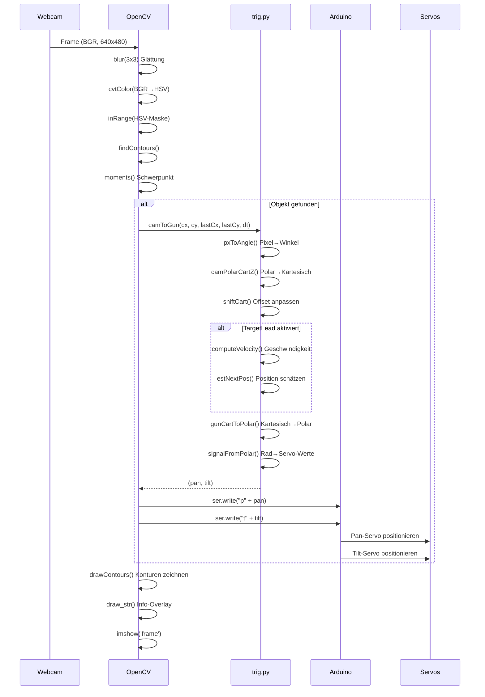
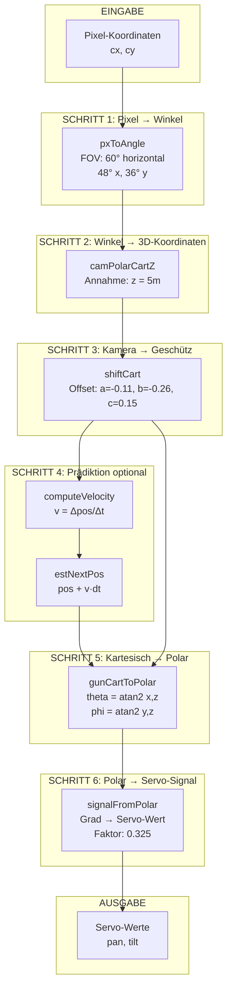
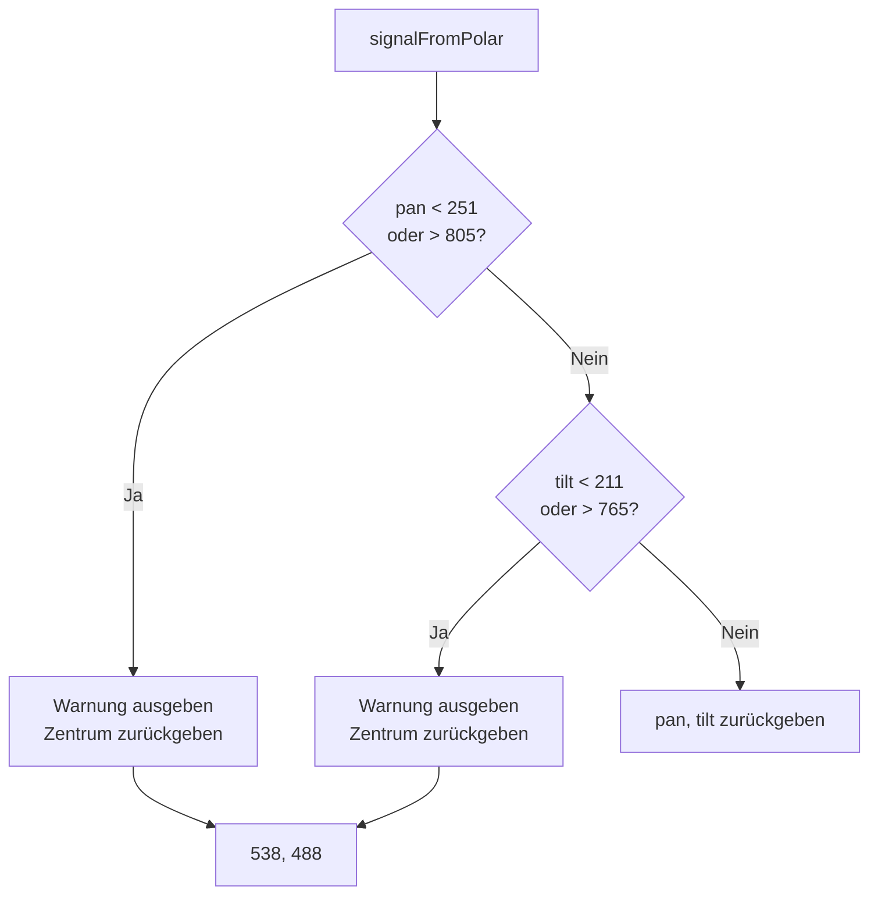

# Funktionaldokumentation: Paintball Sentry Turret

## 1. Projektübersicht

| Eigenschaft | Beschreibung |
|-------------|--------------|
| **Projektname** | Paintball Sentry Turret |
| **Programmiersprache** | Python 2.x (erkennbar an `print` Syntax ohne Klammern) |
| **Plattform** | Laptop mit Webcam + Arduino (Servo-Steuerung) |
| **Hauptzweck** | Automatische Farbverfolgung und Zielerfassung für Paintball-Turret |
| **Repository** | https://github.com/wpdat/paintball-sentry-turret_Mcksen |
| **Kontext** | 4th Year Mechatronics Class Project |

---

## 2. Projektstruktur

```
paintball-sentry-turret_Mcksen/
├── colourTrack.py      # Hauptprogramm - Farbverfolgung & Arduino-Kommunikation (95 Zeilen)
├── trig.py             # Mathematische Koordinatentransformationen (157 Zeilen)
├── calibrateRange.py   # GUI-Tool zur HSV-Farbbereichs-Kalibrierung (65 Zeilen)
├── common.py           # Hilfsfunktionen und OpenCV-Utilities (217 Zeilen)
└── README.md           # Projektdokumentation
```

---

## 3. Verwendete Bibliotheken und Abhängigkeiten

| Bibliothek | Zweck | Verwendet in |
|------------|-------|--------------|
| `cv2` (OpenCV) | Bildverarbeitung, Video-Capture, GUI | Alle Module |
| `numpy` | Numerische Operationen, Arrays | common.py, colourTrack.py, calibrateRange.py |
| `serial` (pyserial) | Serielle Kommunikation mit Arduino | colourTrack.py |
| `math` | Mathematische Funktionen | trig.py |
| `time` | Zeitfunktionen (sleep, strftime) | colourTrack.py |
| `os` | Dateisystem-Operationen | common.py |
| `contextlib` | Context Manager | common.py |
| `itertools` | Iterator-Utilities | common.py |

---

## 4. Hardware-Komponenten

| Komponente | Beschreibung | Schnittstelle |
|------------|--------------|---------------|
| Webcam | Video-Capture (640x480) | USB (cv2.VideoCapture) |
| Arduino | Servo-Steuerung | Seriell (/dev/ttyACM0, 115200 Baud) |
| Servo Pan | Horizontale Bewegung | Arduino PWM |
| Servo Tilt | Vertikale Bewegung | Arduino PWM |
| Laptop | Hauptrechner | - |

---

## 5. Implementierte Module und Funktionen

### 5.1 Modul: `trig.py` - Koordinatentransformationen

| Funktion | Parameter | Rückgabewert | Beschreibung |
|----------|-----------|--------------|--------------|
| `pxToAngle(x, y)` | `x, y: int` | `tuple (theta, phi)` in Rad | Konvertiert Pixel-Koordinaten zu Kamera-Winkeln |
| `camPolarCartZ(theta, phi)` | `theta, phi: float` (Rad) | `tuple (x, y, z)` | Polare zu kartesischen Koordinaten (geschätzte Entfernung) |
| `camPolarCartH(theta, phi, h)` | `theta, phi: float`, `h: int` | `tuple (x, y, z)` | Polare zu kartesisch mit bekannter Objekthöhe |
| `shiftCart(x, y, z)` | `x, y, z: float` | `tuple (x, y, z)` | Verschiebt Koordinaten (Kamera zu Geschütz-Offset) |
| `gunCartToPolar(x, y, z)` | `x, y, z: float` | `tuple (theta, phi)` | Kartesisch zu Geschütz-Polarkoordinaten |
| `signalFromPolar(theta, phi)` | `theta, phi: float` (Rad) | `tuple (pan, tilt)` | Konvertiert zu Servo-Signalwerten |
| `computeVelocity(gunCart, lastGunCart, dt)` | Listen, `dt: float` | `list [vx, vy, vz]` | Berechnet Geschwindigkeitsvektor |
| `estNextPos(gunCart, v, dt)` | Listen, `dt: float` | `list [x, y, z]` | Schätzt nächste Position (Prädiktion) |
| `camToGun(cx, cy, lastCx, lastCy, dt)` | Pixel-Koordinaten | `tuple (pan, tilt)` | **Hauptfunktion**: Komplette Transformation Kamera→Geschütz |

### 5.2 Modul: `common.py` - Hilfsfunktionen und Klassen

#### Klassen

| Klasse | Methoden | Beschreibung |
|--------|----------|--------------|
| `Bunch` | `__init__(**kw)`, `__str__()` | Einfacher Datencontainer (Dictionary-Wrapper) |
| `Sketcher` | `__init__()`, `show()`, `on_mouse()` | Maus-Zeichen-Tool für OpenCV-Fenster |
| `StatValue` | `__init__(smooth_coef)`, `update(v)` | Geglätteter statistischer Wert |
| `RectSelector` | `__init__()`, `onmouse()`, `draw()`, `dragging` | Interaktiver Rechteck-Selektor |

#### Funktionen

| Funktion | Beschreibung |
|----------|--------------|
| `splitfn(fn)` | Zerlegt Dateipfad in Komponenten |
| `anorm2(a)` / `anorm(a)` | Berechnet Vektor-Norm |
| `homotrans(H, x, y)` | Homogene Koordinatentransformation |
| `to_rect(a)` | Konvertiert zu Rechteck-Array |
| `rect2rect_mtx(src, dst)` | Berechnet Transformationsmatrix |
| `lookat(eye, target, up)` | Berechnet Blickrichtungsmatrix |
| `mtx2rvec(R)` | Matrix zu Rotationsvektor |
| `draw_str(dst, (x,y), s)` | Zeichnet Text auf Bild |
| `make_cmap(name, n)` | Erstellt Farbpalette |
| `nothing(*arg, **kw)` | Leere Funktion (Callback-Platzhalter) |
| `clock()` | Gibt OpenCV-Tick-Zeit zurück |
| `Timer(msg)` | Context Manager für Zeitmessung |
| `grouper(n, iterable)` | Gruppiert Iterator-Elemente |
| `mosaic(w, imgs)` | Erstellt Bild-Mosaik |
| `getsize(img)` | Gibt Bildgröße zurück |
| `mdot(*args)` | Multipliziert Matrizen |
| `draw_keypoints(vis, keypoints)` | Zeichnet Keypoints |

### 5.3 Modul: `colourTrack.py` - Hauptprogramm

| Komponente | Typ | Beschreibung |
|------------|-----|--------------|
| `prefArduino` | Preference | Arduino-Kommunikation ein/aus |
| `prefScreen` | Preference | Bildschirm-Anzeige ein/aus |
| `prefTargetLead` | Preference | Zielvorhaltung (Prädiktion) ein/aus |
| `prefWriteVideo` | Preference | Video-Aufzeichnung ein/aus |
| `cap` | VideoCapture | OpenCV Video-Capture Objekt |
| `ser` | Serial | Serielle Verbindung zum Arduino |

### 5.4 Modul: `calibrateRange.py` - Kalibrierungs-Tool

| Komponente | Beschreibung |
|------------|--------------|
| Trackbars (H-, H+, S-, S+, V-, V+) | Interaktive HSV-Bereichseinstellung |
| `nothing(x)` | Callback-Platzhalter für Trackbars |

---

## 6. Aufrufhierarchie

```
┌─────────────────────────────────────────────────────────────────────────────┐
│                           MODULE-ABHÄNGIGKEITEN                              │
└─────────────────────────────────────────────────────────────────────────────┘

┌──────────────────┐     ┌──────────────────┐     ┌──────────────────┐
│  colourTrack.py  │────▶│     trig.py      │     │ calibrateRange.py│
│   (Hauptmodul)   │     │ (Transformationen)│     │  (Kalibrierung)  │
└──────────────────┘     └──────────────────┘     └──────────────────┘
        │                                                 │
        │                                                 │
        └────────────────────┬────────────────────────────┘
                             │
                             ▼
                    ┌──────────────────┐
                    │    common.py     │
                    │  (Hilfsfunktionen)│
                    └──────────────────┘
```

### Detaillierte Aufrufhierarchie (colourTrack.py)

```
┌─────────────────────────────────────────────────────────────────────────────┐
│                        colourTrack.py - Hauptschleife                        │
└─────────────────────────────────────────────────────────────────────────────┘
                                    │
        ┌───────────────────────────┼───────────────────────────┐
        │                           │                           │
        ▼                           ▼                           ▼
┌───────────────┐         ┌──────────────────┐         ┌───────────────┐
│  cap.read()   │         │  cv2.blur()      │         │ cv2.cvtColor()│
│  (Frame)      │         │  (Glättung)      │         │  (BGR→HSV)    │
└───────────────┘         └──────────────────┘         └───────────────┘
                                    │
                                    ▼
                    ┌───────────────────────────────┐
                    │      cv2.inRange()            │
                    │   (HSV-Farbmaske erstellen)   │
                    └───────────────────────────────┘
                                    │
                                    ▼
                    ┌───────────────────────────────┐
                    │    cv2.findContours()         │
                    │     (Konturen finden)         │
                    └───────────────────────────────┘
                                    │
                                    ▼
                    ┌───────────────────────────────┐
                    │    cv2.moments()              │
                    │  (Schwerpunkt berechnen)      │
                    └───────────────────────────────┘
                                    │
                                    ▼
        ┌───────────────────────────────────────────────────────────┐
        │                    trig.camToGun()                         │
        │  ┌─────────────────────────────────────────────────────┐  │
        │  │  pxToAngle() → camPolarCartZ() → shiftCart()        │  │
        │  │  → gunCartToPolar() → signalFromPolar()             │  │
        │  │  [optional: computeVelocity() → estNextPos()]       │  │
        │  └─────────────────────────────────────────────────────┘  │
        └───────────────────────────────────────────────────────────┘
                                    │
                    ┌───────────────┴───────────────┐
                    │                               │
                    ▼                               ▼
        ┌───────────────────┐           ┌───────────────────┐
        │  ser.write()      │           │  cv2.imshow()     │
        │  (Arduino-Befehl) │           │  (Video-Display)  │
        └───────────────────┘           └───────────────────┘
```

---

## 7. User Interface (UI)

### 7.1 UI-Typ
Das Projekt verwendet ein **OpenCV-basiertes GUI** mit mehreren Fenstern.

### 7.2 UI-Komponenten

#### colourTrack.py - Hauptfenster

| Komponente | Implementierung | Beschreibung |
|------------|-----------------|--------------|
| Video-Fenster | `cv2.imshow('frame', frame)` | Live-Video mit Konturen und Info-Overlay |
| Text-Overlay | `draw_str()` | Zeit, Fläche, Pan/Tilt-Werte |
| Beenden | `cv2.waitKey(33) == 27` | ESC-Taste beendet Programm |

#### calibrateRange.py - Kalibrierungsfenster

| Komponente | Implementierung | Beschreibung |
|------------|-----------------|--------------|
| Video-Fenster | `cv2.namedWindow('frame')` | Live-Video mit Farbmaske |
| H- Trackbar | `cv2.createTrackbar('H-', ...)` | Hue Minimum (0-255) |
| H+ Trackbar | `cv2.createTrackbar('H+', ...)` | Hue Maximum (0-255) |
| S- Trackbar | `cv2.createTrackbar('S-', ...)` | Saturation Minimum |
| S+ Trackbar | `cv2.createTrackbar('S+', ...)` | Saturation Maximum |
| V- Trackbar | `cv2.createTrackbar('V-', ...)` | Value Minimum |
| V+ Trackbar | `cv2.createTrackbar('V+', ...)` | Value Maximum |

### 7.3 Visuelle Elemente im Video-Feed

| Element | Farbe | Beschreibung |
|---------|-------|--------------|
| Konturen | Grün `(0,255,0)` | Umrandung erkannte Objekte |
| Schwerpunkt | Weiß `255` | Kreis im Zentrum des Objekts |
| Zeit-Info | Weiß | Verarbeitungszeit in ms |
| Flächen-Info | Weiß | Fläche des größten Konturs in px |
| Pan/Tilt-Info | Weiß | Berechnete Servo-Winkel |

---

## 8. Datenfluss

### 8.1 Datenfluss-Diagramm

```mermaid
flowchart LR
    subgraph Input["📥 INPUT"]
        CAM[Webcam<br/>640x480]
        HSV_RANGE[HSV-Farbbereich<br/>10-40, 70-255, 150-255]
    end

    subgraph Processing["⚙️ BILDVERARBEITUNG"]
        CAPTURE[Frame Capture<br/>cv2.VideoCapture]
        BLUR[Glättung<br/>cv2.blur 3x3]
        HSV[Konvertierung<br/>BGR → HSV]
        MASK[Farbmaske<br/>cv2.inRange]
        CONTOUR[Konturen<br/>cv2.findContours]
        MOMENT[Schwerpunkt<br/>cv2.moments]
    end

    subgraph Transform["📐 TRANSFORMATION"]
        PX_ANGLE[pxToAngle<br/>Pixel → Winkel]
        POLAR_CART[camPolarCartZ<br/>Polar → Kartesisch]
        SHIFT[shiftCart<br/>Kamera → Geschütz]
        VELOCITY[computeVelocity<br/>Geschwindigkeit]
        PREDICT[estNextPos<br/>Prädiktion]
        GUN_POLAR[gunCartToPolar<br/>Kartesisch → Polar]
        SIGNAL[signalFromPolar<br/>Rad → Servo-Signal]
    end

    subgraph Output["📤 OUTPUT"]
        ARDUINO[Arduino<br/>Seriell 115200]
        SERVO_P[Pan Servo]
        SERVO_T[Tilt Servo]
        DISPLAY[OpenCV Display]
    end

    CAM --> CAPTURE
    CAPTURE --> BLUR
    BLUR --> HSV
    HSV_RANGE --> MASK
    HSV --> MASK
    MASK --> CONTOUR
    CONTOUR --> MOMENT
    MOMENT --> PX_ANGLE
    PX_ANGLE --> POLAR_CART
    POLAR_CART --> SHIFT
    SHIFT --> VELOCITY
    VELOCITY --> PREDICT
    PREDICT --> GUN_POLAR
    SHIFT --> GUN_POLAR
    GUN_POLAR --> SIGNAL
    SIGNAL --> ARDUINO
    ARDUINO --> SERVO_P
    ARDUINO --> SERVO_T
    CAPTURE --> DISPLAY
    CONTOUR --> DISPLAY
```



### 8.2 Detailliertes Sequenzdiagramm



---

## 9. Kontrollfluss

### 9.1 Haupt-Kontrollfluss-Diagramm (colourTrack.py)

```mermaid
flowchart TD
    START([Programmstart]) --> INIT_CAP[VideoCapture initialisieren<br/>Device 1]
    INIT_CAP --> INIT_PREF{prefWriteVideo?}
    INIT_PREF -->|Ja| INIT_WRITER[VideoWriter erstellen]
    INIT_PREF -->|Nein| INIT_ARDUINO
    INIT_WRITER --> INIT_ARDUINO{prefArduino?}
    INIT_ARDUINO -->|Ja| INIT_SERIAL[Serial öffnen<br/>/dev/ttyACM0]
    INIT_ARDUINO -->|Nein| LOOP
    INIT_SERIAL --> LOOP
    
    LOOP{Hauptschleife<br/>while 1} --> CAPTURE[Frame aufnehmen<br/>cap.read]
    CAPTURE --> WRITE_CHECK{prefWriteVideo?}
    WRITE_CHECK -->|Ja| WRITE_FRAME[out.write]
    WRITE_CHECK -->|Nein| BLUR
    WRITE_FRAME --> BLUR[Frame glätten<br/>cv2.blur]
    BLUR --> HSV[BGR → HSV<br/>cv2.cvtColor]
    HSV --> MASK[Farbmaske<br/>cv2.inRange]
    MASK --> CONTOURS[Konturen finden<br/>cv2.findContours]
    CONTOURS --> FIND_MAX[Größte Kontur finden<br/>max_area]
    
    FIND_MAX --> HAS_CNT{best_cnt<br/>gefunden?}
    
    HAS_CNT -->|Ja| MOMENTS[Schwerpunkt berechnen<br/>cv2.moments]
    HAS_CNT -->|Nein| SCREEN_CHECK
    
    MOMENTS --> LEAD_CHECK{prefTargetLead<br/>&& t existiert?}
    LEAD_CHECK -->|Ja| CAM2GUN_LEAD[trig.camToGun<br/>mit Prädiktion]
    LEAD_CHECK -->|Nein| CAM2GUN[trig.camToGun<br/>ohne Prädiktion]
    
    CAM2GUN_LEAD --> UPDATE_VARS[t, lastCx, lastCy<br/>aktualisieren]
    CAM2GUN --> UPDATE_VARS
    UPDATE_VARS --> ARDUINO_CHECK{prefArduino?}
    
    ARDUINO_CHECK -->|Ja| SEND_PAN[ser.write pan]
    ARDUINO_CHECK -->|Nein| SCREEN_CHECK
    SEND_PAN --> SEND_TILT[ser.write tilt]
    SEND_TILT --> SCREEN_CHECK
    
    SCREEN_CHECK{prefScreen?} -->|Ja| DRAW_CONTOURS[Konturen zeichnen]
    SCREEN_CHECK -->|Nein| KEY_CHECK
    DRAW_CONTOURS --> DRAW_INFO[Info-Overlay zeichnen]
    DRAW_INFO --> SHOW_FRAME[cv2.imshow]
    SHOW_FRAME --> KEY_CHECK
    
    KEY_CHECK{ESC gedrückt?<br/>waitKey 33 == 27} -->|Nein| LOOP
    KEY_CHECK -->|Ja| CLEANUP
    
    CLEANUP[Aufräumen] --> DESTROY_WIN[cv2.destroyAllWindows]
    DESTROY_WIN --> RELEASE_CAP[cap.release]
    RELEASE_CAP --> WRITER_CHECK{prefWriteVideo?}
    WRITER_CHECK -->|Ja| RELEASE_WRITER[out.release]
    WRITER_CHECK -->|Nein| ARDUINO_CHECK2
    RELEASE_WRITER --> ARDUINO_CHECK2{prefArduino?}
    ARDUINO_CHECK2 -->|Ja| CLOSE_SERIAL[ser.close]
    ARDUINO_CHECK2 -->|Nein| END
    CLOSE_SERIAL --> END([Programmende])
```



### 9.2 Koordinatentransformations-Fluss (trig.py)



---

## 10. Kommunikationsprotokoll

### 10.1 Serielle Kommunikation (Arduino)

| Parameter | Wert |
|-----------|------|
| Port | `/dev/ttyACM0` |
| Baudrate | 115200 |
| Protokoll | Text-basiert |

#### Befehlsformat

| Befehl | Format | Beispiel | Beschreibung |
|--------|--------|----------|--------------|
| Pan | `p<value>\n` | `p538\n` | Horizontaler Servo-Winkel |
| Tilt | `t<value>\n` | `t488\n` | Vertikaler Servo-Winkel |

### 10.2 Servo-Wertebereich

| Servo | Minimum | Zentrum | Maximum |
|-------|---------|---------|---------|
| Pan | 251 | 538 | 805 |
| Tilt | 211 | 488 | 765 |

**Umrechnung:** `Servo-Wert = -degrees(Winkel) / 0.325 + Offset`

---

## 11. Konfigurationsparameter

### 11.1 Preferences (colourTrack.py)

| Variable | Standard | Beschreibung |
|----------|----------|--------------|
| `prefArduino` | 0 (aus) | Arduino-Kommunikation aktivieren |
| `prefScreen` | 1 (ein) | Video-Anzeige aktivieren |
| `prefTargetLead` | 1 (ein) | Zielvorhaltung (Prädiktion) aktivieren |
| `prefWriteVideo` | 0 (aus) | Video-Aufzeichnung aktivieren |

### 11.2 Kamera-Parameter

| Parameter | Wert |
|-----------|------|
| Auflösung | 640 x 480 |
| Field of View | 60° (horizontal) |
| Aspect Ratio | 4:3 |
| X-FOV | 48° |
| Y-FOV | 36° |

### 11.3 HSV-Farbbereich (Standard)

| Kanal | Minimum | Maximum |
|-------|---------|---------|
| Hue | 10 | 40 |
| Saturation | 70 | 255 |
| Value | 150 | 255 |

### 11.4 Geometrische Parameter

| Parameter | Wert | Beschreibung |
|-----------|------|--------------|
| `z` (geschätzt) | 5 m | Standard-Entfernung |
| `objectHeight` | 0.54 m | Bekannte Objekthöhe |
| `a` (Offset X) | -0.11 m | Kamera-Geschütz X-Offset |
| `b` (Offset Y) | -0.26 m | Kamera-Geschütz Y-Offset |
| `c` (Offset Z) | 0.15 m | Kamera-Geschütz Z-Offset |

---

## 12. Fehlerbehandlung

### 12.1 Bereichsprüfungen (trig.py)



### 12.2 Variablen-Checks

| Check | Bedingung | Beschreibung |
|-------|-----------|--------------|
| `best_cnt` | `'best_cnt' in locals()` | Nur verarbeiten wenn Kontur gefunden |
| `t` | `'t' in locals()` | Prädiktion nur nach erstem Frame |
| `dt` | `'dt' in locals()` | Zeit-Info nur wenn berechnet |
| `pan` | `'pan' in locals()` | Servo-Info nur wenn berechnet |

---

## 13. Zusammenfassung

Das **Paintball Sentry Turret** ist ein mechatronisches Projekt, das eine automatische Farbverfolgung und Zielberechnung implementiert. Das System besteht aus:

**Software-Architektur:**
- **colourTrack.py**: Hauptprogramm mit Video-Capture, Bildverarbeitung und Arduino-Kommunikation
- **trig.py**: Mathematische Transformationen von Pixel-Koordinaten zu Servo-Winkeln
- **calibrateRange.py**: Kalibrierungs-Tool zur interaktiven HSV-Farbbereichs-Einstellung
- **common.py**: Wiederverwendbare OpenCV-Hilfsfunktionen und UI-Komponenten

**Kernmerkmale:**
- Echtzeit-Farbverfolgung im HSV-Farbraum
- Kontur-Erkennung mit Schwerpunkt-Berechnung
- 3D-Koordinatentransformation (Kamera → Geschütz)
- Optionale Zielvorhaltung durch Geschwindigkeitsprädiktion
- Serielle Kommunikation mit Arduino für Servo-Steuerung
- Interaktives OpenCV-GUI mit Video-Overlay und Kalibrierungs-Trackbars

**Datenfluss:**
Webcam → Bildverarbeitung → Farbmaske → Konturen → Schwerpunkt → Koordinatentransformation → Servo-Signale → Arduino → Servos